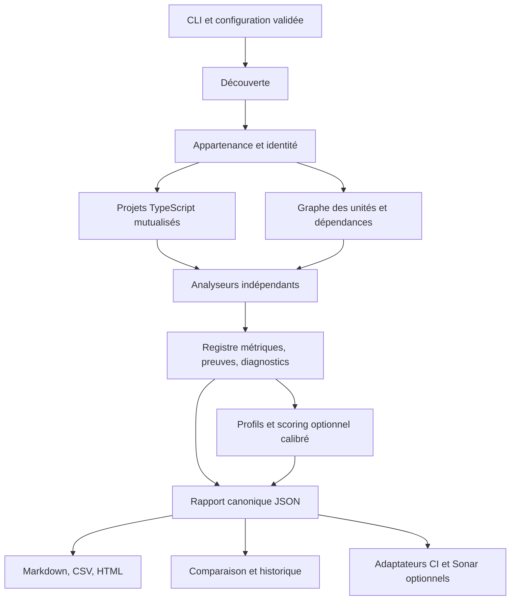

# Frontend Complexity Analyzer — spécification consolidée V4

Date : 15 octobre 2026. **Statut : arbitrages A01–A09 VALIDÉS par l'utilisateur le 15 octobre 2026.** Les détails techniques restent la base de conception à éprouver par les tests réels, puis à ajuster de façon tracée.

Cette V4 consolide les cinq sources sans les remplacer ni les modifier. Une exigence documentée ne constitue pas un arbitrage validé. La numérotation des versions ne permet pas de présumer qu'un document annule un autre. Les exemples de scores ne sont ni des mesures ni un jeu de calibration.

## 1. Arbitrages structurants à valider en premier

Les recommandations de cette table, initialement proposées, ont été explicitement acceptées par l'utilisateur : « Oui. Nous pourrons ensuite itérer suite à mes tests réels ». Les contraintes explicites de la session restent applicables indépendamment de ces choix.

| ID | Choix et conséquence | Recommandation soumise à validation | Origine |
|---|---|---|---|
| A01 | Score global des sources ou restitution séparée ; impact sur modèle, dashboard et comparaison | Valider le principe de l'ADR-001 : trois axes, d'abord sous forme de profils de métriques ; aucun score global par défaut | Proposition antérieure : transmission, ADR-001 |
| A02 | Poids, normalisation, seuils et sens du score de tests | Conserver les deux formules historiques comme références documentaires ; différer tout score numérique et toute alerte 70/90 jusqu'à calibration | Proposition antérieure pour la calibration ; politique détaillée nouvelle |
| A03 | Maintenance, estimation, pilotage ou audit comme usage prioritaire | Prioriser comparaison technique et orientation de maintenance ; ne pas convertir en jours, ni produire de conformité RGAA | Priorité nouvelle ; réserves issues de la transmission |
| A04 | Étendue de la première livraison | MVP local multi-racines + composant isolé, AST, métriques, preuves, Jest/Playwright statiques, JSON/Markdown ; CSV/HTML et comparaison ensuite, intégrations en lots distincts | Découpage nouveau ; capacités issues des sources |
| A05 | Attribution du code partagé et niveau de transitivité | Mesures propres par composant + unités partagées uniques + exposition aux dépendances séparée ; ne jamais sommer les expositions comme du code propre | Principe antérieur, règle précise nouvelle |
| A06 | Mesure absente ou partielle | Valeur absente explicite, diagnostic et couverture d'analyse ; pas de zéro substitué ni de renormalisation silencieuse | Principe antérieur, règle d'agrégation nouvelle |
| A07 | Variantes de complexité cyclomatique | Retenir la convention proposée en §6, versionnée, sans compter à la fois `switch` et ses `case` ; cognitive différée | Arbitrage nouveau, cognitive proposée antérieurement |
| A08 | Identité d'un composant et ambiguïtés de découverte | Répertoire = unité principale, exports = sous-entités ; configuration prioritaire et ambiguïtés explicites | Contexte confirmé pour les répertoires, règles nouvelles |
| A09 | Comparabilité et performances | Bloquer les deltas incompatibles ; définir corpus et machine avant d'accepter l'objectif <5 min | Proposition nouvelle ; objectif documenté |

Validation enregistrée : A01–A09 acceptés ; ADR-001 accepté en conséquence. Aucune formule numérique non définie, pondération, seuil ou conformité RGAA n'est approuvé par cette validation. Les questions de corpus restent ouvertes ; elles ne bloquent pas la préparation de fixtures synthétiques. Les futurs retours de tests réels alimenteront des corrections et arbitrages tracés, sans modifier les cinq spécifications originales.

## 2. Sources et statuts des informations

| Référence | Document original, lien et repérage |
|---|---|
| S1 | [Cahier des charges initial](../specifications/Cahier-des-charges-frontend-complexity-analyzer.md), rubriques nommées non numérotées |
| S2 | [Cahier des charges V2](../specifications/Cahier-des-charges-V2-Frontend-Complexity-Analyzer.md), §1–25 |
| S3 | [Full Specification](../specifications/Frontend-Complexity-Analyzer-Full-Specification.md), §1–35 |
| S4 | [Specification Complete, version déclarée 1.0](../specifications/Frontend-Complexity-Analyzer-Specification-Complete.md), §1–34 |
| S5 | [V3](../specifications/Frontend-Complexity-Analyzer-V3.md), §1–32 |
| C | [Transmission](../context/conversation-handoff.md) : contexte utilisateur confirmé et propositions explicitement séparées |
| D | [ADR-001](../decisions/ADR-001-scoring.md) : ACCEPTED le 15 octobre 2026, après validation de A01–A09 |
| T | [Architecture cible](../architecture/target-architecture.md) : proposition |

**Confirmé par la session** : React/TypeScript, un répertoire par composant, tests Jest/Playwright proches, Windows/VSCode, analyse locale en lecture seule, sources originales préservées. La première session était limitée à la conception ; A01–A09 sont désormais validés. Les instructions AGENTS imposent preuves, statuts, versions, absence de double comptage et interdisent d'inférer la conformité RGAA. La présentation en trois axes est acceptée ; aucun des trois axes ne possède encore de score numérique calibré.

**Exigences documentées** : capacités présentes dans S1–S5, tracées ci-dessous. Leurs divergences restent ouvertes.

**Propositions antérieures** : architecture modulaire de T, AST mutualisé, séparation des trois indicateurs, complexité cognitive, import de résultats existants, couverture d'analyse et calibration.

**Propositions nouvelles** : conventions de comptage, contrats, priorités, frontières de sécurité, règles de comparaison et critères détaillés de cette V4. Tout détail non explicitement attribué à une source ou au contexte confirmé est proposé, pas décidé.

## 3. Matrice de traçabilité des exigences

« — » signifie absence de prescription explicite repérée, jamais rejet. Les cellules renvoient aux sections de chaque document ; S1 utilise les titres. Les lignes groupent des exigences de même famille ; les métriques détaillées sont déclinées au §6. La colonne V4 indique le traitement proposé, pas une suppression d'exigence.

| ID / exigence | S1 | S2 | S3 | S4 | S5 | Traitement V4 |
|---|---|---|---|---|---|---|
| R01 Multi-librairies, découverte React/TSX | Objectifs | 2,4,23 | 2,8,33 | 9,32 | 6,30 | MVP, A08 |
| R02 CLI et configuration externe | Configuration | 20,23 | 6,24 | 7,24 | 24,25 | MVP ; commandes détaillées §5 |
| R03 API : props, callbacks, génériques, objets | Critères 1 | 6 | 7,9 | 8,10 | 7 | MVP |
| R04 Props obligatoires / exports publics | — | 6 (interfaces) | 7 (obligatoires),9 | 8,10 (obligatoires) | 7 (les deux) | Champs distincts |
| R05 Hooks et wrappers React | Critères 2 | 7 | 10 | 11 | 8 | MVP, symboles résolus |
| R06 Complexité cyclomatique | Critères 3 | 8 | 16 | 12 | 14 | MVP, A07 |
| R07 ARIA, rôles, focus, relations | Critères 4 | 9 | 11 | 13 | 9 | Signaux statiques, aucune conformité |
| R08 Clavier : gestionnaires et touches | Critères 5 | 10 | 12 | 14 | 10 | Signaux séparés, pas nombre de comportements prouvés |
| R09 Jest/Vitest, suites/tests/assertions, ratios | Critères 6 | 11 | 13 | 16 | 12 (Jest) | Jest MVP ; Vitest lot suivant |
| R10 Snapshots | — | — | 13 | — | 12 | Extension statique |
| R11 Playwright : scénarios, clavier, focus | Critères 7 | 12 | 14 | 17 | 13 | MVP ; preuves de déclarations |
| R12 Souris, click/fill, assertions accessibilité | — | 12 (souris) | 14 | 17 | 13 (assertions) | Sous-métriques explicites |
| R13 Storybook : stories, variantes, états | — | 13 | 15 | 15 | 11 | Lot suivant ; états estimés |
| R14 LOC, fichiers, dépendances, imports | Critères 8 | — | 17 | 18 | 15 | MVP ; graphe et mesures brutes |
| R15 Score composant, classement global/librairie | Objectifs, Formule | 5,14,16 | 7,18,22 | 8,19,22 | 5,16,19 | A01/A02, différé pour numérique |
| R16 JSON, CSV, HTML | Sorties | 4,16,18 | 20–22 | 21,22 | 18,19 | JSON MVP ; CSV/HTML lot suivant |
| R17 Markdown | — | 4 | — | 21 | 18 | MVP |
| R18 Tendances, historique, comparaison | Vision, Sorties | 17,20 | 23,24 | 23,24 | 20,25 | Lot comparaison, A09 |
| R19 Jenkins, publication/archivage | Intégration Jenkins | 18 | 25 | 25,33 | 22 | Exemple de pipeline différé, publication sur accord |
| R20 Sonar : issues et mesures | Sans dépendance Sonar | 19 | 26 | 27 (+ gates) | 21 | Adaptateur optionnel, jamais prérequis |
| R21 Docker | — | 24 | 27,33 | 26,33 | 23 | Lot intégrations |
| R22 TS strict, Node LTS, ts-morph, outils | Non fonctionnels, Technologies | 4 (AST) | 5,30 | 6,29 | 3 | Stack candidate, versions à fixer au lancement |
| R23 TSDoc/TypeDoc | Documentation | 21,23,24 | 28,29 | 28,32 | 26,27 | Dès premier code, en français |
| R24 Qualité et couverture outil | Non fonctionnels | 23 | 30,31 | 29,30,32 | 30 | §8 ; distinguer couverture outil/librairies |
| R25 Temps <5 minutes | — | 23 | — | — | 30 | Benchmark à définir, A09 |
| R26 Typologies et majorations | Vision (exemples) | 10,15 | 19 | 1 (exemples) | 4 | Tags indicatifs ; majoration non retenue sans validation |
| R27 Guide, exemples, démonstration | Documentation | 24 | 28,33 | 33 | 27 | Livrables du backlog |
| R28 Extensions Git et pilotage externe | Vision produit | 25 (vision) | 34 | 34 (vision) | 15,32 | Après MVP ; aucune conversion automatique en coût |
| R29 Schéma de configuration, validation CLI | — | — | 24 (commande) | — | 24,25 | Schéma complet à produire, exemple S5 insuffisant |
| R30 Angular/Vue/apps métier exclus V1 | — | 2 | — | — | — | Exclusion proposée reconduite |

Les contraintes transversales de lecture seule, preuves, diagnostics, statuts et versions proviennent d'AGENTS et de C/T, pas d'un consensus supposé des cinq documents. L'analyse isolée et la cognitive proviennent de C/T, non d'une exigence commune S1–S5.

## 4. Différences, ambiguïtés et questions ouvertes

### 4.1 Écarts de versions établis

| Sujet | Constat précis | Conséquence / choix encore ouvert |
|---|---|---|
| Poids | S1 Formule et S2 §14 : API 15, React 10, CC 20, accessibilité 25, clavier 20, tests 10. S3 §18, S4 §19, S5 §16 : mêmes poids sauf clavier 15 et maintenabilité 5. Chaque formule totalise 100 % | Aucun ordre de priorité entre formules. C omet S4 dans son résumé : la présente V4 complète ce constat sans modifier C |
| Normalisation | Aucune source ne définit complètement la transformation de tous les comptages en sous-scores comparables 0–100 | Impossible de reproduire les exemples 94/95 ; ne pas implémenter une moyenne de comptages bruts |
| Score API | S3 §9 et S4 §10 : props + 2×callbacks + 3×génériques | Non borné ; callbacks déjà inclus dans props ; supplément intentionnel ou double comptage à arbitrer |
| Cyclomatique | S2 §8, S3 §16, S4 §12 citent `&&` et `||` ; S5 §14 les omet. `switch` et `case` sont tous deux listés ; boucles et `??` non définis | Convention explicite A07, pas une formule « standard » présumée |
| React | S1 ne liste pas useContext/memo/forwardRef ; les suivants enrichissent ; S5 parle de « context » | Séparer appels useContext et création de contexte ; pas d'équivalence implicite |
| ARIA | Listes différentes : `alert` S3, `tabpanel` S4, relations enrichies | Détecter tous les noms aria-* ; dictionnaire des rôles informatif, pas liste fermée de conformité |
| Tests | Vitest explicite S1–S4 mais titre Jest seul en S5 ; snapshots S3/S5 ; conventions *.test/* .spec détaillées surtout S4 | Ne pas interpréter ces différences comme retrait ; configuration et résolution des imports |
| Maintenabilité | Score dans S3/S5, indice non formulé S4 ; imports/profondeur variables | Pas d'indice de maintenabilité inventé ; mesures brutes au MVP |
| Classification | S1–S4 : 0–20/21–40/etc. ; S5 expose surtout seuils 70/90 | Intervalles incomplets pour décimaux ; arrondi, bornes et sévérité à définir après calibration |
| Seuils | 70/90 dans configurations S1/S3/S4 et S5 §17 | Exemples non calibrés ; échelle et direction d'un score de tests inconnues |
| Sonar | S1 sans dépendance à Sonar ; S2–S5 exports, S4 ajoute gates | Compatible si adaptateur facultatif ; format/version/capacités à vérifier lors du lot concerné |
| Temps et couverture | <5 min S2/S5 sans corpus ; >80 % récurrent, S4 §29 dit minimum 80 puis §32 >80 | Cible proposée strictement >80 %, benchmark non contractualisable sans fixture/machine |
| Commandes | `analyzer` S2–S5, `rcca` T ; validate-config S3/S5 seulement | Nom du binaire à valider ; ne pas prétendre les commandes existantes |
| Historique | Fichiers datés au jour dans les sources | Collision possible ; identifiant d'exécution supplémentaire proposé |
| Roadmap | Scoring/reporting/CI/historique en sprints, regroupements différents | Backlog proposé par dépendances ; aucune durée de sprint engagée |

### 4.2 Questions nécessitant une réponse métier ou un corpus

1. Quel usage prioritaire et quel destinataire déterminent A03 ? Un futur score doit-il faciliter un classement, expliquer un composant ou prédire une maintenance ?
2. Quels composants réels de référence, variantes et tailles de librairies peuvent être utilisés localement pour calibrer ? Prévoir Button, Tabs, Combobox, TreeView et des contre-exemples, sans leur assigner de scores a priori.
3. Quelles structures monorepo, alias TS, barrels, exports multiples, composants composés et fichiers partagés rencontre-t-on ? Fournir conventions avant de figer A08.
4. Dispose-t-on de rapports de couverture préexistants et attribuables aux sources, d'historique Git et d'identifiants de version ? Quel format importer en premier ?
5. Qui valide une obligation d'accessibilité et selon quel référentiel/version ? Aucun catalogue normatif n'est défini ici ; une revue humaine est nécessaire.
6. Quelle machine Windows, taille du corpus, mémoire disponible et budget mémoire rendent l'objectif <5 minutes vérifiable ?
7. Quelles versions Jenkins/Sonar et quelles contraintes réseau/archivage s'appliquent aux lots ultérieurs ? Aucun service n'est requis par le MVP.

## 5. Architecture modulaire proposée



| Module candidat | Entrées → sorties | Responsabilité et limite |
|---|---|---|
| cli | arguments → requête validée, code de sortie | Orchestration, progression sur stderr, JSON sur stdout si demandé ; aucune métrique calculée ici |
| configuration | JSON + arguments → configuration résolue | Schéma versionné, erreurs de clés/types, priorité CLI > fichier > défauts ; chemins relatifs au fichier de configuration, CLI au cwd |
| discovery | racines et exclusions → inventaire trié | Exclure node_modules/dist/coverage et sorties ; ne pas suivre les liens hors racines autorisées ; chevauchements de racines dédupliqués ou rejetés |
| ownership | inventaire + conventions → composants/unités/appartenances | Répertoire propriétaire ; exports multiples dans le même composant ; ambiguïtés diagnostiquées ; overrides explicites |
| ast | tsconfig et fichiers → projets et index de symboles | ts-morph candidat ; mutualiser par tsconfig, résoudre alias/imports ; ne jamais importer/exécuter le code analysé ; repli syntaxique signalé |
| graph | symboles/imports → graphe orienté | Distinguer code propre, partagé et externe, imports type/valeur, cycles ; pas d'exploration du code de node_modules |
| analyzers | contexte immuable → mesures et diagnostics | API, React, CC, ARIA/clavier, tests, documentation, architecture ; aucune dépendance aux reporters/scorers |
| registry | définitions + résultats → mesures validées | Identifiant/unité/version uniques, domaine des valeurs, provenance et statut ; rejeter les doublons de clés |
| scoring | métriques + politique calibrée → profil/score expliqué | Désactivé pour les scores non calibrés ; restituer contributions et manquants ; ne pas changer les mesures |
| reporting | rapport canonique → artefacts | JSON de référence ; vues dérivées, échappement HTML/CSV ; assets HTML locaux, aucun appel réseau |
| comparison/history | rapports validés → deltas et séries | Identités stables, entrées/sorties de périmètre, compatibilité des versions ; pas de delta entre métriques incompatibles |
| adapters | rapport final → fichiers d'intégration | Jenkins archives/publish comme exemple, Sonar selon version supportée ; aucune publication automatique |

Frontières : lecture des entrées uniquement ; écritures dans une sortie dédiée hors des racines analysées (refus en cas de recouvrement). Vérifier les chemins canoniques et liens avant écriture ; ne pas appeler `save()` sur les projets AST. La configuration est déclarative JSON, sans plugin exécutable ni fichier JS chargé. Aucun script, test, build ou hook du dépôt inspecté n'est exécuté. Les étapes npm/Jenkins des sources concernent l'outil, pas les librairies inspectées. Aucun code ou rapport n'est transmis à un service.

Identité proposée : `libraryId` explicite en configuration, `componentId = libraryId + chemin relatif du répertoire`, chemins de rapport avec `/`, casse réelle conservée, collision insensible à la casse détectée sous Windows. Les chemins absolus locaux ne définissent pas l'identité. Déplacer un répertoire produit suppression/ajout, sauf table de correspondance explicite. Les barrels réexportent des identités existantes au lieu de créer de nouveaux composants. Les composants non détectables sont listés comme candidats ambigus.

Attribution : une unité source canonique possède au plus un propriétaire. Un fichier partagé est mesuré une fois dans un registre de librairie ; un composant conserve des liens d'utilisation, directs/transitifs séparés. Pour un total de librairie, prendre l'union des unités, jamais la somme des expositions des composants. Exemple : A et B utilisent le même hook U de CC=4 ; U apparaît une seule fois dans le total de code de la librairie ; A et B peuvent chacun afficher une exposition à U, non additive. Les appels du hook dans A/B et son implémentation dans U sont deux métriques distinctes. Les cycles sont condensés avant calcul de profondeur.

Commandes proposées, non disponibles : `analyzer analyze`, `validate-config`, `report`, `compare`, `history`. Le nom `analyzer` reste à arbitrer face à `rcca`. `analyze` accepte plusieurs racines, `--component` avec identifiant non ambigu, `--config`, `--output`, `--format`, `--explain`. `report` relit le JSON sans rescanner. `compare` ne réexécute aucune source. `history` écrit uniquement dans l'espace de rapports.

Configuration candidate : `schemaVersion`, `libraries[{id,root,componentGlobs,tsconfig}]`, `exclusions`, `testPatterns`, `ownershipOverrides`, `outputDirectory`, `formats`, `scoringPolicy?`. Un adaptateur explicite pourra migrer `sourceFolders/reportFolder/historyFolder` des exemples historiques. Les seuils ne sont acceptés qu'avec une politique de score identifiable ; pas de 70/90 actif par défaut. Codes de sortie proposés : 0 succès, 1 analyse partielle, 2 configuration/entrée invalide ou erreur fatale, 3 seuil franchi si politique activée. Un rapport partiel reste exploitable mais son statut doit être visible.

Stack : Node LTS et TS strict requis par le cadre ; ts-morph, commander, Vitest, ESLint, Prettier, TypeDoc candidats issus des sources ; zod/fast-glob candidats de T. Handlebars/Chart.js/Husky sont documentés dans les sources, pas nécessaires au cœur ; choix à confirmer lors du lot concerné. Aucune version de package n'est fixée sans vérification au moment de l'implémentation.

## 6. Catalogue de métriques et conventions proposées

Chaque mesure possède : identifiant stable, définition, unité, périmètre, algorithme/version, statut, preuves et diagnostics. Les comptages syntaxiques peuvent être **mesurés** tout en restant de simples signaux ; leur interprétation comme comportement ou effort est **estimée**. **Indisponible** signifie absence de valeur fiable ; zéro signifie recherche effectuée complètement et aucun élément trouvé. Une analyse partielle doit être estimée avec périmètre observé, ou indisponible si aucune estimation défendable n'est possible.

### 6.1 Code, API et React

| Famille / ID candidat | Définition opérationnelle proposée | Unité / limites |
|---|---|---|
| code.files / code.loc | Fichiers de production uniques ; LOC = lignes physiques contenant au moins un token hors commentaires, lignes mixtes incluses ; tests/stories/générés exclus | fichiers/lignes ; fichiers générés selon exclusions configurées |
| api.props / required / callbacks | Propriétés du type public résolu, noms uniques ; obligatoires = non optionnelles ; callback = propriété callable, comptée aussi dans total | propriétés ; unions : union des noms, obligatoire seulement dans toutes les branches ; héritage DOM séparé du propre |
| api.generics / exports / interfaces | Paramètres de type de l'API exportée ; symboles publics distincts et interfaces accessibles exportées | paramètres/symboles ; alias réexportés dédupliqués |
| api.configDepth | Profondeur maximale des objets de configuration propres, racine=1 ; tableaux ne rajoutent pas de niveau | niveaux ; types récursifs : indisponible avec diagnostic, pas de troncature silencieuse |
| react.calls | Appels résolus aux hooks useState/effect/memo/callback/reducer/ref/context, ventilés par symbole | sites d'appel ; imports renommés reconnus, fonctions homonymes exclues |
| react.wrappers / customHooks | Sites memo/forwardRef distincts ; appels aux hooks locaux distingués des appels React | sites ; ne pas développer récursivement leur contenu dans les comptes propres |
| graph.imports / dependencies | Déclarations d'import séparées des cibles uniques ; dépendances internes par unité et externes par package ; type/valeur séparés | déclarations/unités/packages ; réexports suivis une fois |
| graph.depth / cycles | Plus long chemin dans le graphe interne condensé en composantes fortement connexes ; un nœud isolé a profondeur 0 ; cycles listés | arêtes/cycles ; imports dynamiques non résolus diagnostiqués |

Les événements exposés sont un sous-ensemble des callbacks repérés par convention configurable ; ils ne s'ajoutent pas automatiquement au total API. `any`, spread non résolu, unions incomplètement résolues et imports cassés ne produisent pas de certitude artificielle. Les valeurs par défaut de props ne remplacent pas le caractère optionnel du contrat TypeScript.

### 6.2 Complexité

**Convention CC proposée `cc-v4-proposal-1`** : par corps de fonction, `CC(f)=1+B(f)` ; B compte chaque `if` (donc `else if` une seule fois), clause `case` hors `default`, `catch`, expression ternaire, opérateur `&&` et `||`. Ne pas compter le nœud `switch`, `else`, `default`, `??` ni les boucles dans cette variante. Les boucles restent une métrique distincte ; cette convention restreinte reflète les listes des sources et ne prétend pas couvrir toutes les définitions cyclomatiques. Une alternative incluant les boucles nécessiterait une autre version et validation.

Les fonctions imbriquées ont leur propre base et leurs branches ne sont pas comptées dans leur parent. Publier nombre de fonctions, somme, maximum et distribution ; ne pas confondre somme des CC et CC d'une unique fonction. Pour zéro fonction : somme=0, maximum indisponible. Exemple proposé : fonction avec un `if (a && b)` et un ternaire → CC=4 ; `switch` avec deux `case` et un `default` → CC=3. Ces exemples deviennent des fixtures seulement après validation.

Complexité cognitive : proposition antérieure conservée, **différée** ; pas de formule choisie ici. Avant implémentation, préciser algorithme/version/licence, imbrication, récursion, exceptions et fixtures. Aucun indicateur cognitif ne doit être annoncé comme mesuré au MVP.

### 6.3 Accessibilité et clavier

| ID candidat | Mesure statique | Ce qu'elle ne démontre pas |
|---|---|---|
| a11y.ariaOccurrences / names | Occurrences d'attributs JSX `aria-*` et ensemble des noms distincts | Pertinence, validité des valeurs ou restitution par technologie d'assistance |
| a11y.roles | Attributs role et valeurs littérales distinctes ; valeurs dynamiques signalées | Rôle effectivement calculé dans le DOM, couverture des rôles implicites |
| a11y.relations | Sites aria-controls/labelledby/describedby/activedescendant et références statiquement résolubles | Existence et unicité runtime des cibles |
| a11y.focus / tabIndex / live | Appels focus/blur résolus autant que possible, tabIndex et aria-live | Qualité du parcours, piégeage ou restauration effective du focus |
| keyboard.handlers / keys | Gestionnaires JSX keydown/up/press ; clés littérales dans comparaisons event.key/code ou dispatch résolu | Nombre de parcours, exhaustivité ou correction du comportement |

Ne pas compter une chaîne `Escape` arbitraire comme une interaction ; relier la preuve à une condition clavier. Conserver valeur originale et normalisation (`' '`/`Space`/`Spacebar`, key vs code) avec version. Un même site compte une fois par métrique ; publier occurrences et clés distinctes séparément. Les spreads JSX et comportements délégués rendent les conclusions incomplètes.

Un profil d'obligations/effort demande des patterns documentés et une validation humaine ; le nom « TreeView » ne suffit pas à déduire un pattern, une majoration ou une conformité. Les assertions d'accessibilité trouvées dans les tests ne démontrent pas qu'elles ont été exécutées. Tout éventuel audit RGAA est un autre processus avec référentiel/version et preuves adaptées.

### 6.4 Tests, stories et documentation

| ID candidat | Convention proposée | Statut / limite |
|---|---|---|
| tests.files / suites / declarations / assertions | Résoudre imports Jest/Vitest/Playwright ; compter fichiers, describe, it/test, expect séparément | Mesuré pour déclarations résolues ; `.each` : une déclaration, nombre de cas distinct seulement si statiquement déterminable |
| tests.disabled / focused / snapshots | `.skip`, `.todo`, `.only` et appels snapshot identifiés séparément | Ni skip ni todo comptés comme tests actifs ; aucune inférence de succès |
| tests.perProp / perLoc | Tests actifs déclarés attribués / props propres, ou / LOC production du même composant | Ratio ; dénominateur 0 → indisponible avec motif, pas Infinity ni zéro |
| playwright.actions | Déclarations de scénarios ; keyboard.press, click/fill, assertions focus/accessibilité résolues | Mesuré pour les sites, estimation pour « parcours » ; locator seul n'est pas une interaction |
| coverage.imported | Import ultérieur d'un rapport existant, version/corpus/chemins vérifiés | Indisponible par défaut ; jamais déduit du nombre de tests |
| stories.exports | Exports de stories CSF reconnus, variantes/états/playgrounds documentés séparément | Déclarations mesurées ; exhaustivité des états estimée ; aucun import/exécution Storybook |
| docs.publicDocumented | Exports publics avec TSDoc / exports éligibles, descriptions et tags appropriés | Ratio ; qualité sémantique non prouvée, pas d'obligation de @param sans paramètre |
| git.churn | Extension ultérieure explicitement activée : fenêtre, référence Git et lignes modifiées | Indisponible MVP ; aucune estimation de coût sans données historiques |

Les motifs `*.test.ts(x)`, `*.spec.ts(x)` ne suffisent pas à identifier le framework. En cas d'ambiguïté, diagnostic et configuration ; les tests colocalisés sont attribués au répertoire sauf preuve/override contraire. Les tests multi-composants sont des unités de test partagées ; pas de duplication dans les totaux de librairie. L'absence de fichier de test dans un scan complet donne zéro déclaration, jamais 0 % de couverture exécutée.

### 6.5 Scores et agrégats

MVP proposé : profils de métriques brutes, pas de score chiffré non calibré. Les trois axes A01 sont des vues explicatives ; ils ne prétendent pas mesurer des heures d'accessibilité ou une probabilité de défaillance. Un total de librairie est calculé sur l'union des unités ; les moyennes/maxima de métriques par composant sont nommés explicitement, pas présentés comme « score global ».

Contrat futur d'une politique : objectif, version, population de calibration, fonction de normalisation par métrique, sens, domaine et unité, poids, corrélations/doubles comptages, traitement des estimés/manquants, seuils et règle d'arrondi. Une formule candidate `S=Σ(wᵢ×nᵢ(xᵢ))`, avec `Σwᵢ=1`, n'est utilisable que si tous ces éléments sont définis. Si une entrée requise manque : score indisponible par défaut ; aucune redistribution des poids. Les profils affichent séparément disponibilité et qualité des preuves. Les scores historiques ne sont comparables qu'avec politiques et algorithmes compatibles.

## 7. Contrats TypeScript proposés (documentation uniquement)

Ces extraits ne sont pas du code livré ni compilé. Ils expriment les invariants attendus ; schémas JSON, validations runtime et TSDoc complet de chaque export seront nécessaires lors de l'implémentation.

```ts
/** Localise une observation dans une source, avec des lignes à partir de 1. */
interface Evidence {
  libraryId: string;
  relativePath: string;
  startLine: number;
  endLine: number;
  kind: 'ast' | 'syntax' | 'imported-report' | 'manual';
}

/** Décrit une limite sans incorporer le contenu confidentiel du fichier. */
interface Diagnostic {
  id: string;
  code: string;
  severity: 'info' | 'warning' | 'error';
  message: string;
  evidence?: Evidence;
}

/** Sépare une absence de mesure d'une valeur numérique nulle. */
type Observation =
  | { status: 'measured'; value: number }
  | { status: 'estimated'; value: number; rationale: string }
  | { status: 'unavailable'; value: null; reason: string };

/** Porte une mesure traçable et son périmètre exact. */
interface Metric {
  id: string;
  algorithmVersion: string;
  unit: 'count' | 'lines' | 'ratio' | 'depth' | 'score';
  subjectId: string;
  scope: 'own' | 'shared' | 'exposure';
  observation: Observation;
  evidence: readonly Evidence[];
  diagnosticIds: readonly string[];
}

/** Identifie une unité sans dupliquer le code partagé. */
interface SourceUnit {
  id: string;
  libraryId: string;
  relativePath: string;
  ownerComponentId: string | null;
  kind: 'production' | 'test' | 'story';
  usedByComponentIds: readonly string[];
  metrics: readonly Metric[];
}

/** Représente le composant-répertoire et ses exports. */
interface ComponentReport {
  id: string;
  libraryId: string;
  relativeDirectory: string;
  displayName: string;
  exportSymbolIds: readonly string[];
  ownUnitIds: readonly string[];
  sharedUnitIds: readonly string[];
  metrics: readonly Metric[];
  diagnosticIds: readonly string[];
}

/** Décrit la complétude de l'analyse, distincte de la couverture de tests. */
interface AnalysisCoverage {
  discoveredFiles: number;
  excludedFiles: number;
  eligibleFiles: number;
  analyzedFiles: number;
  partialFiles: number;
  failedFiles: number;
  unresolvedCandidateIds: readonly string[];
}

/** Conserve les versions requises pour une comparaison honnête. */
interface AnalysisReport {
  schemaVersion: string;
  toolVersion: string;
  runId: string;
  generatedAt: string;
  status: 'complete' | 'partial';
  configurationFingerprint: string;
  algorithmVersions: Readonly<Record<string, string>>;
  libraries: readonly { id: string; revision?: string }[];
  units: readonly SourceUnit[];
  components: readonly ComponentReport[];
  coverage: AnalysisCoverage;
  diagnostics: readonly Diagnostic[];
  scoringPolicyVersion?: string;
}

/** Expose uniquement les lectures et index nécessaires à un analyseur. */
interface AnalysisContext {
  componentId: string;
  ownUnitIds: readonly string[];
  sharedUnitIds: readonly string[];
  getSourceText: (unitId: string) => string;
  // L'index AST en lecture seule sera typé après choix de l'adaptateur.
}

/** Retourne des données sans écrire de rapport ni calculer de score. */
interface Analyzer {
  id: string;
  version: string;
  metricIds: readonly string[];
  analyze(context: AnalysisContext): Promise<{
    metrics: readonly Metric[];
    diagnostics: readonly Diagnostic[];
  }>;
}
```

Invariants à valider : valeurs finies ; comptes entiers ≥0 ; ratios ≥0, non nécessairement ≤1 pour tests/props ; lignes ≥1 et fin ≥début ; unicité `(subjectId,id,scope,algorithmVersion)` ; références d'unités/diagnostics existantes ; chaque métrique mesurée possède une preuve ou une preuve d'inventaire complet pour zéro. `eligibleFiles = analyzedFiles + partialFiles + failedFiles`, catégories disjointes. La liste d'exclusions et le fingerprint permettent d'expliquer le dénominateur. Aucun contenu source n'est incorporé par défaut dans les rapports ; une preuve est une localisation.

Les ensembles (noms ARIA, touches, rôles, arêtes du graphe) nécessiteront des observations détaillées liées aux métriques, sans les encoder en faux nombres. Leur schéma est une tâche P1 avant l'analyseur concerné. Les scores futurs nécessiteront un contrat séparé avec contributions et politique ; `score: number` obligatoire des anciens modèles n'est pas reconduit automatiquement.

## 8. Critères d'acceptation vérifiables proposés

| ID | Scénario / résultat attendu | Références / lot |
|---|---|---|
| AC01 | Deux librairies contenant chacune Button donnent deux identités distinctes ; filtrer un identifiant n'analyse que le périmètre demandé | R01, A08 / MVP |
| AC02 | Sur fixtures de composants fonctionnels, memo, forwardRef, alias et barrels, exports et propriétaires attendus sont identifiés ; ambiguïtés listées | R01,R05 / MVP |
| AC03 | Hashes des sources/configs inspectées identiques avant/après ; fixture avec script sentinelle jamais exécuté ; sortie dans une racine refusée, y compris via lien | Cadre lecture seule / MVP |
| AC04 | Hook partagé par deux composants mesuré une seule fois dans total librairie ; liens d'exposition des deux visibles ; cycle n'entraîne pas de récursion infinie | A05 / MVP |
| AC05 | Fixtures chiffrées pour chaque métrique, dont fonctions imbriquées, CC §6.2, alias React, spreads, zéros et dénominateurs nuls | R03–R14,A06,A07 / MVP |
| AC06 | Fichier non parsable/import irrésolu produit diagnostic localisé et statut partiel ; aucune valeur zéro substituée ; couverture d'analyse cohérente | A06 / MVP |
| AC07 | Chaque valeur est reliée à version/périmètre/preuves ; JSON validé par schéma ; tri stable, nombres finis et références valides | Cadre traçabilité / MVP |
| AC08 | Deux exécutions sur mêmes sources/config/versions donnent métriques et identités identiques ; dates et runId exclus de la comparaison déterministe | R15 / MVP |
| AC09 | Jest/Playwright homonymes, skip/todo/only, each et fichier *.spec ambigu sont traités selon conventions ; absence de rapport exécuté ≠ couverture zéro | R09–R12 / MVP |
| AC10 | Rapports ARIA/clavier indiquent signaux et limites ; aucune mention « conforme RGAA », aucun bonus TreeView basé sur le nom | R07,R08,R26 / MVP |
| AC11 | Config invalide échoue avant analyse ; stdout/stderr et codes de sortie documentés ; chemins Windows avec espaces et accents couverts en E2E | R02,R29 / MVP |
| AC12 | JSON et Markdown restituent les mêmes métriques, manquants et diagnostics ; HTML/CSV ultérieurs échappent les données sans réseau | R16,R17 / lots rapports |
| AC13 | Compare détecte ajout/suppression, exclut changements d'algorithme/périmètre incompatibles ; historique ne remplace pas un run du même jour | R18,A09 / lot comparaison |
| AC14 | Lint, typecheck, tests, build et génération TypeDoc de l'outil exécutés ; couverture outil >80 % sur lignes/branches/fonctions/statements proposée | R23,R24 / dès premier code |
| AC15 | Benchmark reproductible décrit corpus, fichiers/LOC/composants, machine, Node, mémoire maximale et 3 runs froids ; chacun <300 s sur corpus convenu | R25,A09 / avant engagement performance |
| AC16 | Si scoring approuvé plus tard : contributions vérifiables, calibration et sens documentés ; entrée requise absente → score indisponible ; comparaison compatible seulement | R15,A01,A02 / lot calibration |
| AC17 | Pipeline exemple exécute les contrôles de l'outil puis analyse/archivage ; Docker lit des entrées montées en lecture seule ; Sonar est facultatif | R19–R21 / intégrations |

Le seuil de couverture de l'outil ne prouve pas la validité scientifique des métriques : revue de fixtures et calibration restent nécessaires. Les corpus de librairies réelles restent locaux et leurs scripts ne sont pas exécutés. La performance est un objectif hérité dont le protocole doit encore être accepté ; aucun résultat de benchmark n'est revendiqué dans cette V4.

## 9. Backlog priorisé et livraisons proposées

P0 = décisions préalables ; P1 = MVP ; P2 = enrichissement ; P3 = intégrations/évolutions. Le report d'une capacité ne l'annule pas. Aucun chiffrage en jours ou sprint n'est déduit des scores.

| Ticket | Priorité / dépendances | Livrable et fin vérifiable |
|---|---|---|
| B00 Arbitrages | P0 | Réponses A01–A09, usage métier, ADR-001 explicitement accepté/modifié/rejeté ; autorisation d'implémenter |
| B01 Corpus et conventions | P0, B00 | Structures anonymisées/locales, fixtures attendues, protocole Windows et performance ; questions §4.2 traitées ou reportées explicitement |
| B02 Socle outil | P1, B00 | TS strict, scripts qualité/build, Vitest, TSDoc français/TypeDoc, guide contributeur ; AC14 |
| B03 Schémas et configuration | P1, B01–B02 | Schémas configuration/rapport/observations, migration exemples anciens documentée, validation et codes CLI ; AC07,AC11 |
| B04 Scan et appartenance | P1, B03 | Multi-racines, exclusions, identité, tests colocalisés, overrides ; AC01–AC03 |
| B05 AST et graphe | P1, B04 | Mutualisation tsconfig, résolution symboles/alias, unités partagées, cycles ; AC02,AC04,AC06 |
| B06 Métriques code/API/React/CC | P1, B05 | Définitions §6 versionnées et fixtures chiffrées, preuves ; AC05–AC08 |
| B07 ARIA/clavier | P1, B05 | Observations détaillées, signaux statiques/limites, aucune inférence normative ; AC05,AC10 |
| B08 Jest/Playwright | P1, B05 | Attribution, déclarations/actions et ratios, aucune exécution ; AC09 |
| B09 CLI et rapports MVP | P1, B06–B08 | analyze/validate-config/report, JSON/Markdown, guides Windows et rapports de démonstration synthétiques ; AC07,AC11,AC12 |
| B10 Revue MVP/performance | P1, B09 | E2E lecture seule/déterminisme, contrôles qualité, protocole performance exécuté ; AC03,AC08,AC14,AC15 |
| B11 Rapports enrichis | P2, B09 | CSV/HTML locaux : détails, classements de métriques, radar seulement si axes comparables et expliqués ; AC12 |
| B12 Comparaison/historique | P2, B09 | compare/history, compatibilité, mapping de renommage et runId ; AC13 |
| B13 Vitest/Storybook/TSDoc | P2, B05 | Métriques déclaratives documentées et fixtures, limites sur états/playgrounds ; R09,R10,R13,R23 |
| B14 Calibration | P2, B10 + validation métier | Profils revus, politique de score éventuelle, validation sur corpus distinct, seuils/agrégations explicités ; AC16 ; aucun score garanti comme livrable |
| B15 Couverture importée | P2, B08 | Format choisi et versionné, correspondance sources/révision, manquants explicites ; jamais lancement de tests inspectés |
| B16 Jenkins/Docker | P3, B10–B12 | Exemples de pipeline, archivage et conteneur reproductible, guide publication sous accord ; AC17 |
| B17 Sonar | P3, B16 | Étude des formats et versions effectivement supportés, adaptateur sans dépendance du cœur, tests de contrat ; AC17 |
| B18 Cognitive/Git/extensions | P3, B10 | ADR algorithme cognitif, churn défini, étude Power BI/GitHub Action/GitLab CI/tendances trimestrielles selon besoin |

## 10. État de livraison de cette session

Livraison documentaire : cette V4, matrice S1–S5, écarts, arbitrages, architecture, contrats proposés, conventions, critères et backlog. Le README pointe vers cette proposition. Les cinq spécifications, C, D et T restent inchangés. Aucun fichier TypeScript, package, analyseur, CLI ou pipeline n'est créé.

Validation de conception enregistrée après livraison : A01–A09 acceptés le 15 octobre 2026. Les questions de corpus restent ouvertes. Contrats non compilés, schémas et benchmarks non implémentés ; aucune métrique réelle ni conformité ni score calibré revendiqué. Les références aux technologies décrivent les sources et candidats, sans vérification externe de leurs versions/capacités actuelles.
