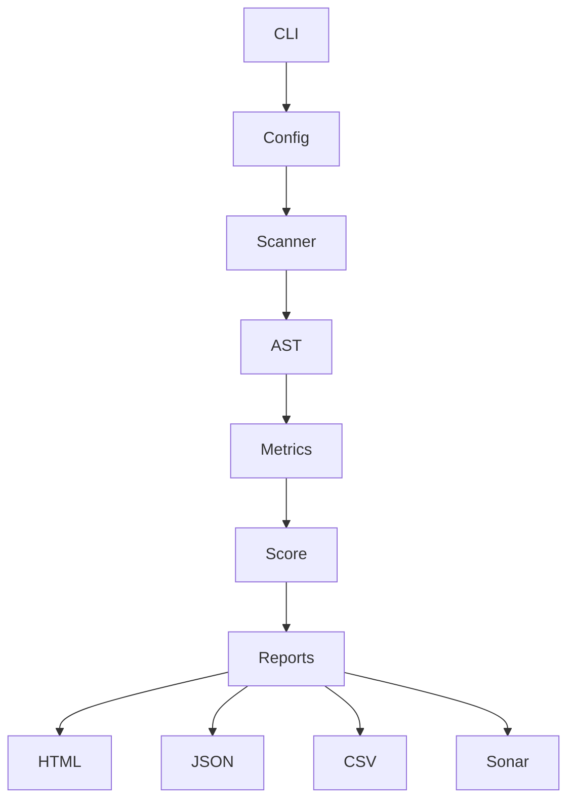

# Frontend Complexity Analyzer
## Dossier complet de spécifications fonctionnelles et techniques

Version : 1.0

---

# 1. Contexte

La Squad Communs du Dev maintient plusieurs librairies React/TypeScript exposant des composants conformes :

- au Design System d'entreprise ;
- aux exigences RGAA ;
- aux recommandations WAI-ARIA ;
- aux standards de développement internes.

Exemples :

- Button
- Link
- Checkbox
- Radio
- Tabs
- Accordion
- Modal
- Menu
- Select
- Combobox
- TreeView
- DataTable
- DatePicker

L'objectif est de disposer d'un outil interne permettant de mesurer objectivement la complexité, la maintenabilité et le coût d'évolution de ces composants.

---

# 2. Objectifs

## Objectifs métier

- Objectiver les estimations.
- Prioriser les efforts de maintenance.
- Identifier les composants critiques.
- Valoriser les efforts liés à l'accessibilité.
- Produire des indicateurs de patrimoine.

## Objectifs techniques

- Analyse automatique.
- Exécution en local.
- Exécution Jenkins.
- Génération de rapports.
- Historisation.
- Documentation automatique.

---

# 3. Cas d'usage

## UC01 - Analyse locale

Le développeur lance l'analyse d'un repository.

## UC02 - Analyse CI

L'analyse est exécutée dans Jenkins.

## UC03 - Comparaison de versions

Comparaison entre deux rapports.

## UC04 - Pilotage produit

Consultation du dashboard HTML.

---

# 4. Architecture cible



---

# 5. Structure du projet

```text
src/
 ├── cli/
 ├── configuration/
 ├── scanner/
 ├── analyzers/
 │    ├── api/
 │    ├── react/
 │    ├── accessibility/
 │    ├── keyboard/
 │    ├── tests/
 │    └── maintainability/
 ├── scoring/
 ├── reporting/
 ├── history/
 ├── sonar/
 ├── models/
 └── utils/
```

---

# 6. Technologies retenues

- Node.js LTS
- TypeScript strict
- ts-morph
- commander
- handlebars
- chart.js
- eslint
- prettier
- vitest
- typedoc
- husky

---

# 7. Configuration

## analyzer.config.json

```json
{
  "sourceFolders": ["libs"],
  "excludedFolders": [
    "node_modules",
    "dist",
    "coverage"
  ],
  "reportFolder": "reports",
  "historyFolder": "history",
  "thresholds": {
    "warning": 70,
    "error": 90
  }
}
```

---

# 8. Modèle de données

```ts
export interface ComponentMetrics {
  componentName: string;
  filePath: string;

  loc: number;

  propsCount: number;
  requiredPropsCount: number;
  callbackPropsCount: number;

  hooksCount: number;

  ariaAttributesCount: number;
  ariaRoleCount: number;

  keyboardInteractionsCount: number;

  cyclomaticComplexity: number;

  jestTestsCount: number;
  playwrightTestsCount: number;

  storiesCount: number;

  score: number;
}
```

---

# 9. Détection des composants

Critères :

- fichier *.tsx
- fonction React exportée
- composant forwardRef
- composant memo

Exemples détectés :

```ts
export function Button() {}
```

```ts
export const Button = () => {}
```

```ts
export const Button = forwardRef(...)
```

---

# 10. Analyse API

Mesures :

- nombre de props
- props obligatoires
- callbacks
- objets complexes
- types génériques

Formule :

```text
apiScore =
props
+ callbacks × 2
+ generics × 3
```

---

# 11. Analyse React

Mesures :

- useState
- useEffect
- useMemo
- useCallback
- useReducer
- useRef
- useContext
- memo
- forwardRef

---

# 12. Complexité cyclomatique

Comptage AST :

- if
- else if
- switch
- case
- catch
- &&
- ||
- ?: 

Formule :

```text
Complexity = 1 + branches
```

---

# 13. Analyse accessibilité

## Attributs ARIA

- aria-label
- aria-labelledby
- aria-describedby
- aria-controls
- aria-expanded
- aria-selected
- aria-current
- aria-activedescendant
- aria-live

## Rôles ARIA

- button
- dialog
- tab
- tabpanel
- menu
- menuitem
- listbox
- option
- combobox
- tree
- treeitem

## Focus

Détection :

```ts
focus()
blur()
```

```tsx
 tabIndex={0}
```

---

# 14. Analyse clavier

Touches recherchées :

```text
ArrowUp
ArrowDown
ArrowLeft
ArrowRight
Home
End
Enter
Escape
Space
Tab
PageUp
PageDown
```

Gestionnaires recherchés :

```tsx
onKeyDown
onKeyUp
onKeyPress
```

---

# 15. Analyse Storybook

Fichiers :

```text
*.stories.tsx
```

Métriques :

- nombre de stories
- variantes
- playgrounds
- états documentés

---

# 16. Analyse Jest/Vitest

Détection :

```text
*.test.ts
*.test.tsx
```

Mesures :

- describe
- it
- test
- expect

Ratios :

```text
Tests / Props
Tests / LOC
```

---

# 17. Analyse Playwright

Détection :

```text
*.spec.ts
```

Mesures :

- scenarios
- page.keyboard.press
- click
- fill
- accessibility assertions

---

# 18. Maintenabilité

Mesures :

- lignes de code
- nombre de fichiers
- profondeur imports
- dépendances

Indice :

```text
Maintainability Score
```

---

# 19. Score global

```text
API                15%
React              10%
Complexité         20%
Accessibilité      25%
Clavier            15%
Tests              10%
Maintenabilité      5%
```

## Classification

```text
0-20   Simple
21-40  Faible
41-60  Modéré
61-80  Complexe
81-100 Très complexe
```

---

# 20. Exemple de résultat

```json
{
  "component":"TreeView",
  "score":94,
  "props":36,
  "aria":19,
  "keyboard":14,
  "tests":164
}
```

---

# 21. Rapports générés

## JSON

report.json

## CSV

report.csv

## Markdown

report.md

## HTML

index.html

---

# 22. Dashboard HTML

Sections :

1. Résumé exécutif
2. Top composants complexes
3. Classement accessibilité
4. Classement clavier
5. Tendances
6. Radar composant
7. Historique

---

# 23. Historisation

```text
history/
  2026-01-01.json
  2026-02-01.json
```

Fonctions :

- comparaison de versions
- évolution mensuelle
- dette technique

---

# 24. CLI

```bash
analyzer analyze
```

```bash
analyzer compare old.json new.json
```

```bash
analyzer report
```

```bash
analyzer history
```

---

# 25. Jenkins

```groovy
pipeline {
  agent any

  stages {
    stage('Install') {
      steps {
        sh 'npm ci'
      }
    }

    stage('Lint') {
      steps {
        sh 'npm run lint'
      }
    }

    stage('Test') {
      steps {
        sh 'npm run test'
      }
    }

    stage('Build') {
      steps {
        sh 'npm run build'
      }
    }

    stage('Analyze') {
      steps {
        sh 'npm run analyze'
      }
    }
  }
}
```

---

# 26. Docker

```dockerfile
FROM node:lts
WORKDIR /app
COPY . .
RUN npm ci
RUN npm run build
CMD ["npm","run","analyze"]
```

---

# 27. SonarQube

Exports :

- Generic Issues
- External Metrics
- Quality Gates

---

# 28. Documentation

## TSDoc

```ts
/**
 * Analyse un composant React.
 *
 * @param filePath chemin du fichier.
 * @returns métriques calculées.
 */
```

## TypeDoc

```bash
npx typedoc
```

---

# 29. Standards qualité

ESLint obligatoire.

Prettier obligatoire.

TypeScript strict.

Couverture minimale :

```text
80%
```

---

# 30. Plan de tests

## Unitaires

- scanner
- analyzers
- scoring

## Intégration

- analyse repo réel

## Non régression

- snapshots rapports

---

# 31. Roadmap

Sprint 1
- Scanner
- AST

Sprint 2
- Analyse API
- Analyse React

Sprint 3
- Accessibilité
- Clavier

Sprint 4
- Reporting

Sprint 5
- Jenkins
- Sonar

Sprint 6
- Historisation

---

# 32. Critères d'acceptation

- Analyse multi librairies
- Configuration externalisée
- Exécution locale
- Intégration Jenkins
- Rapport HTML
- Rapport JSON
- Comparaison historique
- TypeDoc généré
- Couverture > 80%

---

# 33. Livrables

- Code source TypeScript
- Pipeline Jenkins
- Dockerfile
- Documentation développeur
- Documentation utilisateur
- TypeDoc
- Rapports exemples

---

# 34. Vision long terme

L'outil doit devenir la référence de mesure de complexité des composants Design System et permettre à terme :

- le suivi du patrimoine frontend ;
- la valorisation de l'effort RGAA ;
- le pilotage produit ;
- la mesure de la dette technique ;
- la comparaison inter-librairies ;
- la comparaison inter-versions ;
- la production d'indicateurs exploitables par PO, Lead Dev, Architectes et Managers.
