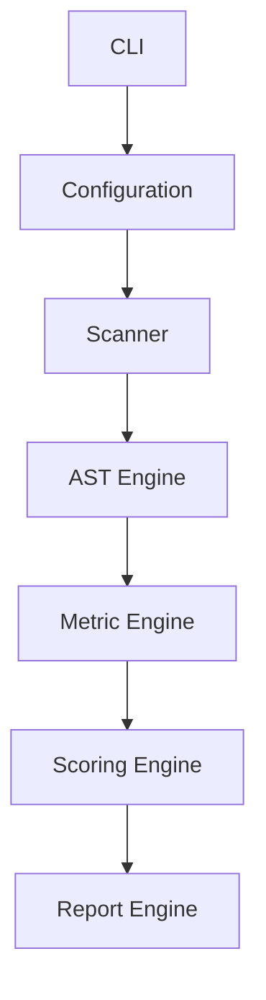
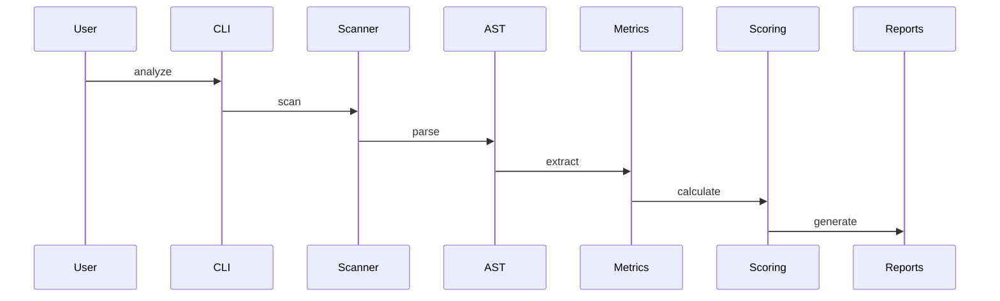

# Frontend Complexity Analyzer V3

## Résumé exécutif

Outil industriel d'analyse de complexité des composants React/TypeScript d'un Design System.

Objectifs :
- Mesurer objectivement la complexité.
- Valoriser les efforts RGAA/WAI-ARIA.
- Alimenter la roadmap produit.
- Produire des indicateurs CI/CD.
- Comparer les versions d'une librairie.

# 1. Architecture d'entreprise



# 2. Architecture projet

```text
src/
 ├─ cli/
 ├─ configuration/
 ├─ scanners/
 ├─ analyzers/
 ├─ scorers/
 ├─ reporters/
 ├─ history/
 ├─ sonar/
 ├─ models/
 ├─ templates/
 └─ utils/
```

# 3. Stack technique

- TypeScript strict
- Node.js LTS
- ts-morph
- commander
- handlebars
- chart.js
- vitest
- eslint
- prettier
- husky
- typedoc

# 4. Domaine métier

## Composants simples
- Button
- Link
- Badge

## Composants intermédiaires
- Tabs
- Accordion
- Modal

## Composants avancés
- DatePicker
- Menu
- Select

## Composants experts
- Combobox
- TreeView
- DataTable

# 5. Modèle de données

```ts
interface ComponentReport {
  componentName: string;
  filePath: string;
  score: number;
  apiScore: number;
  accessibilityScore: number;
  interactionScore: number;
  technicalScore: number;
  testScore: number;
  maintainabilityScore: number;
}
```

# 6. Moteur AST

Analyse :
- interfaces
- types
- props
- hooks
- JSX
- attributs ARIA
- gestionnaires clavier
- complexité cyclomatique

# 7. Métriques API

Mesures :
- nombre de props
- props obligatoires
- callbacks
- objets imbriqués
- génériques
- exports publics

# 8. Métriques React

Détection :
- useState
- useEffect
- useMemo
- useReducer
- useRef
- useCallback
- forwardRef
- memo
- context

# 9. Métriques Accessibilité

Analyse :
- roles
- aria-*
- tabIndex
- focus()
- blur()
- aria-live
- aria-controls
- aria-activedescendant

# 10. Métriques clavier

Touches :
- ArrowUp
- ArrowDown
- ArrowLeft
- ArrowRight
- Home
- End
- Enter
- Escape
- Tab
- PageUp
- PageDown
- Space

# 11. Métriques Storybook

- nombre de stories
- variantes
- états documentés
- playgrounds

# 12. Métriques Jest

- describe
- it
- test
- expect
- snapshots

# 13. Métriques Playwright

- scénarios
- parcours clavier
- gestion focus
- assertions accessibilité

# 14. Complexité cyclomatique

Formule :

```text
1 + if + else if + switch + case + catch + ternaires
```

# 15. Maintenabilité

Mesures :
- LOC
- nombre de fichiers
- profondeur imports
- dépendances
- churn Git futur extensible

# 16. Scoring

```text
API                15%
React              10%
Complexité         20%
Accessibilité      25%
Clavier            15%
Tests              10%
Maintenabilité      5%
```

# 17. Seuils

```json
{
  "warning":70,
  "error":90
}
```

# 18. Rapports

## JSON
## CSV
## Markdown
## HTML

# 19. Dashboard HTML

Sections :
- Vue exécutive
- Top complexes
- Tendances
- Radar composant
- Analyse accessibilité
- Analyse qualité

# 20. Historisation

```text
history/
  yyyy-mm-dd.json
```

Fonctions :
- comparaison versions
- progression
- dette technique

# 21. Export Sonar

- Generic Issues
- Mesures personnalisées

# 22. Jenkins

```groovy
stage('Install')
stage('Lint')
stage('Test')
stage('Build')
stage('Analyze')
stage('Publish')
```

# 23. Docker

```dockerfile
FROM node:lts
WORKDIR /app
COPY . .
RUN npm ci
RUN npm run build
CMD ["npm","run","analyze"]
```

# 24. Configuration JSON Schema

```json
{
  "$schema":"https://json-schema.org/draft/2020-12/schema"
}
```

# 25. CLI

```bash
analyzer analyze
analyzer report
analyzer compare
analyzer history
analyzer validate-config
```

# 26. Convention TSDoc

Chaque export public doit contenir :
- description
- @param
- @returns
- @example
- @throws

# 27. TypeDoc

```bash
npx typedoc
```

# 28. Diagramme de séquence



# 29. Backlog

## Epic 1
Framework

## Epic 2
Métriques

## Epic 3
Scoring

## Epic 4
Reporting

## Epic 5
CI/CD

## Epic 6
Historisation

# 30. Critères d'acceptation

- Multilibrairies
- Jenkins compatible
- TypeDoc généré
- Couverture >80%
- Temps <5 min
- Rapports HTML générés

# 31. Roadmap

Sprint 1 : Scanner + AST

Sprint 2 : Métriques

Sprint 3 : Scoring

Sprint 4 : Reporting

Sprint 5 : Jenkins + Sonar

Sprint 6 : Historisation

# 32. Valeur métier

Le score produit doit permettre d'objectiver la charge de développement, maintenance et accessibilité des composants Design System afin d'éclairer les arbitrages produit et techniques.
